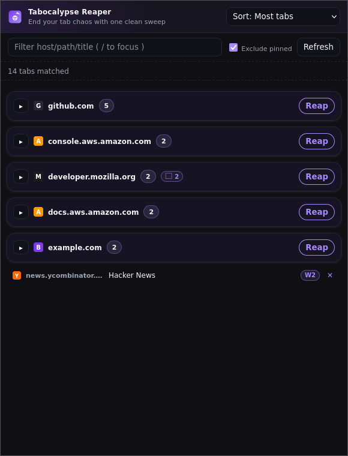
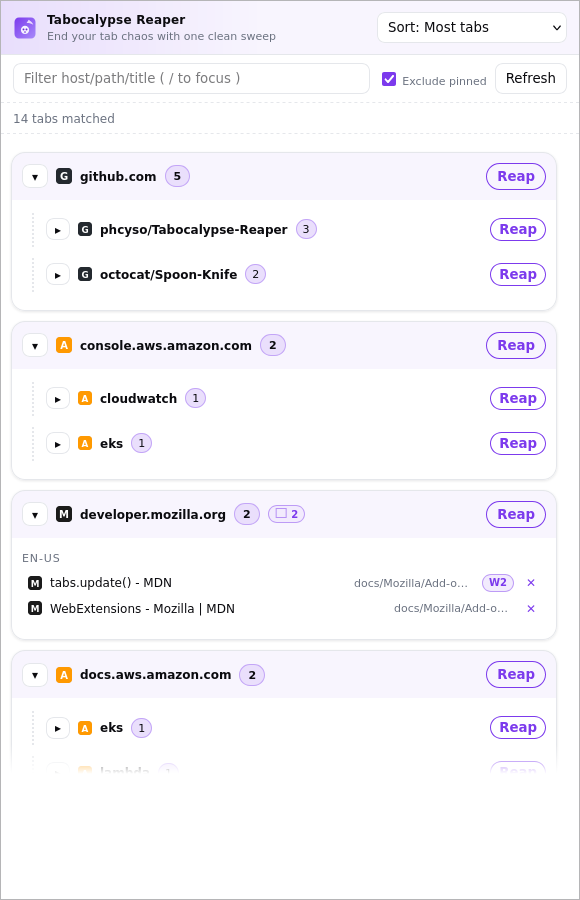

# Tabocalypse Reaper

[](https://github.com/phcyso/Tabocalypse-Reaper/actions/workflows/pr-build.yml)
[](https://github.com/phcyso/Tabocalypse-Reaper/actions/workflows/release.yml)

**End your tab chaos with one clean sweep.** A Firefox extension that groups
your open tabs by **host → cluster**, shows favicons for fast scanning, and
lets you *reap* entire groups with one click — guarded by a confirmation for
big sweeps.

## Features

- **Host → cluster grouping** — every open tab lands under its host and a
  meaningful cluster (first path segment, with special handling for GitHub
  `org/repo` URLs and AWS consoles/docs).
- **Reap groups safely** — close a whole cluster or host with one button;
  sweeps of ≥ 10 tabs ask for confirmation first. Pinned tabs are marked and
  never reaped by accident.
- **Undo** — every bulk reap stores a snapshot and shows a "Reaped N · Undo"
  toast for 8 seconds; undoing restores tabs to their window, with pin state.
- **Reap stale** — rows carry relative-age chips ("3h", "2d"); sort by
  staleness and reap a host's tabs older than 24 h in one click.
- **Close duplicates** — tabs sharing a normalized URL are marked "×N"; one
  button keeps the most recent copy and reaps the rest.
- **Accurate counts** — host badges show unique tab counts across windows.
- **Favicons everywhere** — host, cluster, and row icons for fast scanning,
  with deterministic letter-avatar fallbacks when a favicon is missing.
- **Cross-window aware** — rows from other windows carry "W2"-style chips,
  hosts spanning windows show "⧉ N", and clicking a row activates the tab
  *and* raises its window.
- **Compact at scale** — single-tab hosts collapse to one row and big
  sessions auto-collapse, so 50+ tabs stay scannable instead of becoming an
  11-screen scroll.
- **Theme aware** — colours follow your Firefox theme, with a native
  light/dark fallback; themed borders keep the popup readable on any page.
- **Filters & sorting** — live substring filter (debounced, `/` to focus),
  count/A→Z/stale sorting, "exclude pinned" toggle; preferences persist for
  the session, and a pill warns when the visible order is outdated.
- **Incremental UI** — closes and count updates re-render in place; a
  150-tab session renders instantly.

## Install

### From Firefox Add-ons (AMO)

> Coming soon — the extension is being prepared for
> [addons.mozilla.org](https://addons.mozilla.org/). This section will link
> directly to the listing once it is approved.

### From GitHub Releases

Tagged releases (`v*`) publish a downloadable zip on the
[Releases page](https://github.com/phcyso/Tabocalypse-Reaper/releases).
Note: the release `.zip` is **unsigned** — Firefox only loads unsigned
extensions temporarily (`about:debugging`), so for permanent installation use
the AMO listing above once available.

Releases also carry a `*-source.zip` — the source-code package for AMO
reviewers (the shipped extension is compiled from TypeScript). Regenerate
it locally with `npm run package:source`.

### Temporary install (development)

```bash
npm install
npm run prepare
```

1. Open `about:debugging#/runtime/this-firefox`
2. **Load Temporary Add-on…**
3. Select `dist/manifest.json`

## Permissions & privacy

| Permission | Why |
|---|---|
| `tabs` | Enumerate open tabs (title/URL/favicon) and close the ones you reap. |
| `storage` | Remember your sort order and "exclude pinned" choice for the session, and keep the last reap so Undo works. |
| `theme` | Match the popup's colours to your Firefox theme. |
| `tabGroups` | Name and colour your existing Firefox tab groups in the list. |
| `contextualIdentities` | Label rows with their container's name and colour. |

**Tabocalypse Reaper collects no data.** Everything stays in your browser:
no analytics, no network requests, no remote code. Declared in the manifest
via `data_collection_permissions: ["none"]`. Full policy: [PRIVACY.md](PRIVACY.md).

## Screenshots

Canonical UI shots live in [`docs/img/`](docs/img/) and are regenerated with:

```bash
npm run screens
```

| | |
|---|---|
|  |  |
| *Overview — dark theme* | *Hosts expanded into clusters — light theme* |

The capture pipeline (headless Firefox + WebDriver BiDi over the harness
fixtures) and the interactive shots (confirm dialog, popup in browser context)
are documented in the capture script — see `scripts/capture-screens.mjs`.

A larger marketing suite — themed, real-Firefox scenario shots (50+ tab
piles, GitHub/AWS clustering, pinned-tab safety) plus AMO-ready 1280×800
composites — is regenerable end-to-end via the Docker pipeline; see
[docker/README.md](docker/README.md).

## Source layout

- `src/`: TypeScript source, organized by feature area (`browser/`, `dom/`, `model/`, `theme/`, `utils/`, plus `popup.ts`), along with HTML, CSS, the manifest, icons, and static assets.
- `tests/`: Vitest unit tests (URL helpers, tab model, renderer, storage, theme).
- `tests/fixtures/`: generated popup-harness pages for UI testing without an extension build.
- `scripts/`: build/copy/harness tooling.
- `docker/`: headed validation and the marketing screenshot pipeline
  (Selenium end-to-end test, scenario runner, AMO composites).
- `website/`: source for the GitHub Pages site (CI builds it on `website/**` changes; publishing pending Pages enablement).
- `docs/`: design notes ([DESIGN.md](docs/DESIGN.md)) and testing workflows.
- `dist/`: generated output. Created by `npm run prepare`; do not edit by hand.
- `web-ext-artifacts/`: build archives emitted by `npm run build` (ignored in git).
- [AGENT.md](AGENT.md): architecture, contracts, and conventions for human *and* AI contributors — read it before changing the model or renderer.
- [SOUL.md](SOUL.md): what this project is, and refuses to be — product principles and taste. Read it before adding features.

## CI/CD pipeline

### Pull request builds (`.github/workflows/pr-build.yml`)
Triggered on **all pull requests** to the `main` branch:
1. Runs `npm run lint` (type-checks, runs Vitest unit tests, rebuilds `dist/`, and executes `web-ext lint` against the compiled bundle).
2. Runs `npm run build` to produce an **unsigned** package via the TypeScript pipeline and `web-ext build`.
3. Uploads the build artifact to the PR.

**Retrieving PR artifacts:**
1. Navigate to the pull request page
2. Scroll to the bottom and look for the "Checks" section
3. Click on "PR Build" workflow run
4. Download the `firefox-extension-unsigned` artifact from the "Artifacts" section
5. Extract the `.zip` file and install it temporarily in Firefox (see Install instructions above)

### Release builds (`.github/workflows/release.yml`)
Triggered on **pushes of `v*` tags**:
1. Checks out the tag, runs `npm run lint` (type-check, Vitest unit tests, rebuild `dist/`, `web-ext lint` on the compiled bundle).
2. Runs `npm run build` to emit the artifact through the TypeScript pipeline and `web-ext build`.
3. Creates a GitHub Release for the tag and attaches the build artifact.

Bump the version in `src/manifest.json` and `package.json` manually **before** tagging.

### Website deploys (`.github/workflows/deploy-website.yml`)
Builds and publishes the site with `actions/deploy-pages` on every
`website/**` change, or on demand via `workflow_dispatch` (Pages source:
GitHub Actions).

### Version management

Versions are bumped **manually** — update `version` in `src/manifest.json` and
`package.json`, commit, then tag `vX.Y.Z` and push the tag to cut the release.

**Guidelines:** patch = bug fixes · minor = new features, backwards-compatible · major = breaking changes.
See [Firefox extension versioning guidelines](https://extensionworkshop.com/documentation/publish/updating-your-extension/).

## Local development

```bash
npm install        # install dependencies
npm run dev        # live-reload dev server (TS watch + asset watch + web-ext run)
npm run prepare    # compile TypeScript + stage assets into dist/
npm run typecheck  # type-check without emitting output
npm run test       # run the Vitest unit suite
npm run lint       # typecheck + tests + rebuild + web-ext lint
npm run build      # distributable .zip in web-ext-artifacts/
npm run verify:popup  # rebuild + regenerate harness fixtures + run tests
```

`npm run dev` requires Firefox; `web-ext run` starts an isolated instance with
a throwaway profile. For keyboard-driven end-to-end testing in a real Firefox,
see [docs/e2e-firefox-testing.md](docs/e2e-firefox-testing.md); the popup can
also be exercised as a plain page via the harness fixtures — see
[docs/playwright-harness.md](docs/playwright-harness.md).

## Contributing

Issues and PRs are welcome! Please read [CONTRIBUTING.md](CONTRIBUTING.md) and
[AGENT.md](AGENT.md) (architecture contracts and conventions) before your
first change.

## License

[GPL-3.0-or-later](LICENSE) © Kim Dowling
